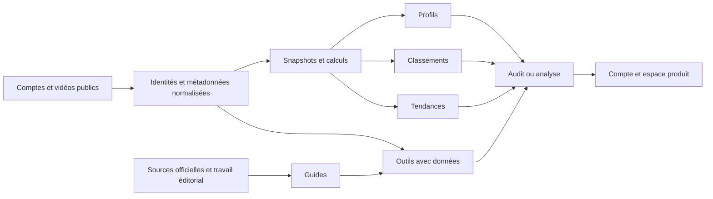

# Kabo → Base.tube : cartographie et moteur de contenu

Audit réalisé le **3 octobre 2026**, à partir des pages publiques et du code local Base.tube. Les recommandations ci-dessous sont une proposition, pas des fonctionnalités livrées.

**Conclusion : Kabo construit un corpus de données réutilisable, puis le transforme en plusieurs portes d’entrée vers son produit. Base.tube gagnerait à reproduire ce mécanisme autour des thumbnails, titres et audits de chaînes YouTube, en y ajoutant des analyses originales.** Le gros manque est la couche publique d’exemples et de recherche, davantage que le nombre d’articles.

## 1. Couverture et livrables

- Les **500 URL distinctes** du [sitemap Kabo](https://kabo.sh/sitemap.xml) ont été récupérées : **500 HTTP 200**, un H1 chacune, aucune directive `noindex` dans les meta robots HTML observées. Ces observations ne prouvent ni l’indexation Google ni la fonctionnalité des outils.
- Les **27 URL** du [sitemap public Base.tube](https://base.tube/sitemap.xml) ont été récupérées : **27 HTTP 200**, dont **12 articles**. Ce chiffre décrit le sitemap observé, pas un inventaire exhaustif de tout ancien article WordPress ou de toute URL hors sitemap.
- Titres, descriptions, H1/H2/H3, canonicals, types JSON-LD, liens et texte ont été conservés dans `kabo-crawl.json` et `base-crawl.json`. Les titres SVG ont été exclus du titre du document lors de la consolidation.
- Chaque URL Kabo a une ligne dans `inventaire-kabo-500.csv`, avec famille, plateforme, état de couverture Base.tube, route existante ou proposée, priorité et besoins de données. Les 69 outils et 38 guides disposent aussi de fichiers séparés.
- Lecture du code marketing, du socle `/thumbnails`, du frontend de l’audit et de ses points d’entrée backend. Aucune modification du produit ou publication.
- Vérification du catalogue Monid et test restreint de collecte YouTube ; détails et limites dans la section données.
- Aucun accès aux analytics de Kabo, à son Search Console ou à ses conversions : **l’architecture est vérifiée ; son succès SEO commercial ne l’est pas**. Aucun volume de mots-clés ou revenu d’acquisition n’a été inventé.

Pour « AI Channel », hypothèse de travail : l’audit de chaîne YouTube de Base.tube. Si ce terme désigne un autre produit, la comparaison de ses fonctions reste à compléter ; la cartographie Kabo reste utilisable.

## 2. Le contenu exact du sitemap

| Famille | Pages | Part | Fonction probable dans l’acquisition |
|---|---:|---:|---|
| Profils de créateurs | 222 | 44,4 % | Requêtes nom + statistiques, abonnés, revenus estimés, meilleures vidéos |
| Classements de créateurs | 143 | 28,6 % | Requêtes « top channels », niche et pays |
| Outils gratuits | 69 | 13,8 % | Répondre à une tâche immédiatement, puis proposer le produit |
| Guides | 38 | 7,6 % | Répondre à une question, diagnostic ou besoin de workflow |
| Pages de tendances | 8 | 1,6 % | Recherche récurrente de vidéos et formats à étudier |
| Hubs | 11 | 2,2 % | Navigation, découverte et maillage |
| Institutionnel / légal / installation | 9 | 1,8 % | Confiance, accès et identité du produit |
| **Total** | **500** | **100 %** | |

**373 pages, soit 74,6 % du sitemap, appartiennent aux profils, classements et tendances.** C’est une architecture de recherche et de données autant qu’une architecture éditoriale.

Les hubs : `/tools`, `/tools/youtube`, `/tools/instagram`, `/tools/tiktok` ; `/guides` ; `/creators`, `/creators/youtube`, `/creators/instagram`, `/creators/tiktok` ; `/trending`, `/trending/youtube`.

Les 9 autres pages : `/`, `/install`, `/about`, `/ai-info`, `/privacy`, `/terms`, `/app/privacy`, `/app/terms`, `/app/delete-account`.

### Profils : 106 YouTube + 63 Instagram + 53 TikTok

Patron : `/creators/{platform}/{handle}`.

Le [profil MrBeast](https://kabo.sh/creators/youtube/mrbeast) combine un snapshot daté, statistiques, historique, vidéos marquantes, séparation Shorts/long format, résumé et FAQ. Il relie aussi les autres plateformes et propose de passer à l’audit ou à l’analyse d’une vidéo. Les revenus affichés sont des estimations avec hypothèses.

L’intérêt pour Base.tube : une personne cherchant un créateur pourrait découvrir une analyse de son packaging, puis auditer sa propre chaîne. Cette conversion est une **hypothèse à mesurer** ; une page de statistiques de célébrité peut également attirer des visiteurs sans intérêt pour le produit.

### Classements : 137 YouTube + 2 Instagram + 2 TikTok + 2 transversaux

Les **137 classements YouTube** comprennent **77 pays** et **60 autres listes** : global, creator education et sujets. Ils incluent, par exemple, tech, gaming, food, coding, AI, ASMR, Minecraft, true crime et travel. Les 60 ne reposent pas tous sur la même taxonomie : certains sujets viennent des catégories publiques YouTube, d’autres d’une découverte thématique.

Le [classement France](https://kabo.sh/creators/youtube/top/france) documente sa source, son snapshot et les limites du champ pays. Le [classement tech](https://kabo.sh/creators/youtube/top/tech) explique l’utilisation des topics publics. Le [classement AI](https://kabo.sh/creators/youtube/top/ai) précise que YouTube n’a pas de catégorie AI équivalente et que les candidats sont découverts par sujet.

**Attention : le nombre de comptes dans le corpus n’est pas le nombre de profils SEO publiés.** Les pages de classements annoncent un corpus bien plus large que les 222 profils détaillés du sitemap. On ne peut donc pas reconstruire ce moteur avec seulement 222 comptes, ni prendre ce corpus pour un recensement exhaustif de la plateforme.

### Les 8 pages de tendances

1. `/trending/most-viewed-youtube-videos` — all time.
2. `/trending/youtube-videos-this-week` — nouvelles vidéos de la semaine.
3. `/trending/most-viewed-youtube-videos-24-hours` — vidéos publiées dans la fenêtre de 24 heures au snapshot.
4. `/trending/youtube-outlier-videos` — multiples de la médiane de la chaîne.
5. `/trending/youtube-shorts-this-week` — Shorts.
6. `/trending/instagram-reels-this-week` — Reels.
7. `/trending/most-viewed-youtube-videos-this-month` — nouvelles vidéos du mois.
8. `/trending/instagram-reels-outliers` — multiples de la médiane du compte.

La [page outliers YouTube](https://kabo.sh/trending/youtube-outlier-videos) affiche une méthode et des liens vers les vidéos. La collecte est annoncée deux fois par jour. Les tendances YouTube indiquent une couverture US et un pool de découverte limité ; « trending » n’est pas un recensement universel.

La page « last 24 hours » classe des **vidéos publiées dans cette fenêtre**, pas les vidéos ayant gagné le plus de vues pendant les dernières 24 heures. Il faut deux snapshots comparables pour mesurer ce second indicateur.

### Les 69 outils : six fonctions récurrentes

L’inventaire séparé contient les 69 URL, sans sélection. Le regroupement ci-dessous décrit les fonctions, sans compter deux fois une même page.

| Fonction | Exemples observés | Données ou calcul nécessaires |
|---|---|---|
| Extraire / retrouver | transcript, thumbnail, tags, channel ID, avatar, banner | Métadonnées et captions disponibles |
| Générer | titres, scripts, descriptions, idées, captions, bios, calendrier | Modèle + contraintes + contexte ; recherche publique pour certains |
| Calculer | engagement, revenus estimés, délais watch hours, tarifs influenceur | Formules explicites + données ou entrées utilisateur |
| Diagnostiquer | audit, video analyzer, 0 views, shadowban checker | Échantillon + analyse ; limites des données publiques |
| Découvrir | similar channels/accounts, sons, recherches tendances | Recherche + qualification + snapshots |
| Préparer / prévisualiser | thumbnail preview/resizer, Reel cover preview, media kit | Outil local ou génération de document |

Kabo ajoute parfois des preuves au générateur : titres avec vérification dans le catalogue existant, idées accompagnées de vidéos récentes, scripts calés sur une vidéo de référence. La [page YouTube ideas](https://kabo.sh/tools/youtube-video-ideas-generator) en est un exemple.

**Les formulaires, promesses et limites ont été lus ; les 69 outils n’ont pas été exécutés.** « Free » varie selon la page : quota anonyme, compte pour enlever certaines limites, résultats partiellement visibles. La page [trending sounds](https://kabo.sh/tools/trending-tiktok-sounds) expose par exemple un extrait et propose un compte gratuit pour ouvrir la suite.

### Les 38 guides

Chaque guide est nommé dans `guides-38.csv` avec son H1 et sa priorité proposée. Ils couvrent :

- **Packaging, diagnostic et mesure** : baisse de vues YouTube/TikTok ; vidéos virales ; vues vs engaged views ; vidéos qui gagnent des followers ; vidéos republiées ; chaîne supposément identifiée comme AI ; limites d’un reviewer AI.
- **Création et organisation** : template de script ; hooks et son ; série de contenus ; calendrier avec exemple de semaine ; Claude + Notion ; imperfection volontaire ; « yap content » ; prompts et coût de montage AI.
- **Règles et monétisation** : reused content ; chaînes faceless ; watch hours ; exigences/délais YPP annoncés pour 2027 ; label AI TikTok ; règles TikTok ; vérification d’une monétisation ; Bilibili LATAM.
- **Brand deals** : tarif, réponse à une demande de tarif, vérification de collaboration.
- **Fonctions de plateforme** : handle vs channel ID ; taille de banner ; TikTok features/Search Insights/Stories/photos ; Instagram First Draft.

Les titres fondés sur des changements de règles ou des dates doivent être revérifiés auprès de la plateforme avant d’être repris. Le sitemap ne valide pas leurs affirmations.

## 3. Reverse engineering du mécanisme

Ce schéma est une **reconstruction à partir des pages**, pas une lecture de leur backend.

Les briques à reproduire :

1. **Identité stable.** Conserver l’ID de chaîne et de vidéo, pas seulement le handle.
2. **Historique.** Un snapshot actuel donne un état ; plusieurs donnent une évolution mesurée.
3. **Vues dérivées du même corpus.** Une chaîne sert aux profils, rankings, comparaisons et outils. Ne pas recollecter pour chaque page.
4. **Gabarits avec matière spécifique.** Tables, exemples, dates, méthode, limites et FAQ propres à l’objet. Un paragraphe différent avec le même tableau vide ne suffit pas.
5. **Maillage contextuel.** Une fiche mène vers un audit avec le compte concerné ; une vidéo vers son analyse ; un guide vers l’outil permettant l’étape suivante.
6. **Continuité vers le produit.** Préserver le contexte de recherche lors de l’inscription. Kabo le décrit dans la FAQ de son [audit](https://kabo.sh/tools/youtube-channel-audit).
7. **Contenu utilisable par les moteurs.** Le texte et les données principales sont accessibles dans le HTML. JSON-LD observé : 69 `WebApplication`, 38 `Article`, 148 `CollectionPage`, 219 `FAQPage`, entre autres. Cela décrit le balisage, pas une garantie d’affichage enrichi.
8. **Identité pour assistants.** `/ai-info` documente le produit et annonce des miroirs `/answers/*.txt`. Les miroirs sont mentionnés ; ils n’ont pas été recensés ni testés dans cet audit et ne figurent pas dans les 500 URL.

## 4. Ce que Base.tube a déjà

Le [site public](https://base.tube) relie les outils de croissance aux AI Thumbnails, à l’audit et au Content Pass. Ce dernier donne à Base.tube une direction commerciale supplémentaire : transformer une audience en acheteurs directs.

Dans les 27 URL du sitemap :

- Accueil, Content Pass, AI Thumbnails, landing YouTube Channel Audit.
- Hub outils.
- Six entrées de contrôle/préparation : thumbnail size checker, resizer, preview, tester, title checker, video-to-thumbnail.
- `/tools/ctr-optimizer` : page qui annonce un produit en développement ; ne pas la compter comme moteur CTR disponible.
- Blog + 12 articles + 2 pages légales.

Les 12 articles couvrent déjà CTR, fabrication et règles de thumbnails, générateurs AI, monétisation, comparatifs, outils de création et mises à jour produit. Il faut organiser ce socle et le relier aux outils plutôt que recréer ses sujets sous de nouvelles URL concurrentes.

Le code `/thumbnails` prévoit des pages par jeu/style/genre et un hub. **`live-pages.json` contient `hub: null` et `pages: []` ; Fortnite est `status: draft` avec placeholders.** Le hub devient indexable lorsque suffisamment de pages complètes existent. C’est un accélérateur déjà construit mais encore sans corpus public.

L’audit de chaîne est centré sur le packaging : positionnement, observations, hypothèses, expériences et swipe file. La landing demande un compte gratuit ; l’analyse n’a pas de score de CTR prédictif. Le frontend lu gère les retours OAuth, mais pas un préremplissage général du canal depuis une nouvelle page publique. Le lancement du funnel « analyser cette chaîne » nécessitera donc ce passage de contexte.

## 5. Les manques, avec priorité

Les statuts CSV signifient **absence ou recouvrement dans le sitemap public audité**. Ils ne prouvent pas qu’aucun ancien contenu ou composant interne ne peut être réutilisé.

| Famille | État Base.tube | Travail à entreprendre | Priorité |
|---|---|---|---|
| Profils / analyses de chaînes | Aucune famille publique équivalente | 20 analyses YouTube sélectionnées, avec données et packaging | P1 |
| Outliers | Pas de page publique | Board dans 3 niches, méthode et snapshots | P1 |
| Galerie par niche | Infrastructure présente, zéro page publiée | 6 pages complètes avec exemples originaux | P1 |
| Outils Kabo | 3 équivalents parmi les 69 : audit, preview, resizer | Sélectionner les outils qui alimentent le packaging | P1/P2 |
| Guides basés sur une investigation | Blog existant, couverture limitée | 8 guides reliés à des exemples et outils | P1 |
| Classements | Famille absente | 3 à 5 collections sélectionnées par niche/taille | P2 |
| Comparaisons de chaînes | Famille absente | Paires comparables ; sujet, format, taille et période | P2 |
| Tendances IG/TikTok | Familles absentes | Extension si le produit traite réellement ces plateformes | P3 |
| Comptes célèbres et tops par pays | Famille absente | Élargir seulement après preuve de conversion | P3 |
| Contenu de vente directe | Content Pass + articles existants | Cas, prix et chemins de vente reliés aux créateurs | P2, propre à Base.tube |

**66 outils Kabo n’ont pas d’équivalent direct dans le sitemap audité. Cela ne signifie pas qu’il faut en construire 66.** Le title checker n’est pas un title generator, le choix manuel de variantes n’est pas un test CTR mesuré, et l’audit de packaging n’est pas une analyse vidéo intégrale.

### A. Bibliothèque publique de chaînes — 20 pages pilotes

Route proposée : `/creators/youtube/{handle}`. H1 conseillé : « {Creator} : thumbnail patterns, titles and standout videos », adapté à l’anglais du site.

Chaque page doit apporter :

- Identité, niche et sources ; date de collecte.
- 20 à 50 vidéos dans un échantillon documenté ; Shorts/live/long format séparés.
- 3 à 5 exemples avec titre, thumbnail, date et performance publique observée.
- Lecture originale de la composition, texte, promesse et relation titre/image.
- Ce qui distingue certains exemples, ce qui reste une hypothèse, et une expérience possible.
- Liens « regarder », « étudier le packaging », « tester une variante », « auditer ma chaîne ».

MKBHD, Veritasium et MrBeast sont des candidats connus à qualifier. Ajouter surtout des chaînes de taille proche des utilisateurs visés. Éviter que tout le corpus soit constitué de célébrités impossibles à reproduire.

### B. Outliers qui servent le packaging

Route : `/trending/youtube-outlier-videos`. Éventuelles variantes par niche seulement avec corpus suffisant.

Classer par multiple d’un baseline **documenté**, puis donner une lecture du titre et de la thumbnail. Montrer format, âge, taille de chaîne, date de mesure et nombre de comparables.

Une vidéo à 300k sur une chaîne habituellement à 20k est une piste d’enquête. Ce ratio ne démontre pas que la thumbnail a causé la hausse. De même, une vidéo publiée il y a trois ans et une vidéo de trois jours ne forment pas un benchmark équitable.

### C. Les six premières pages `/thumbnails`

Candidats à valider par demande réelle : Fortnite, Minecraft, tech review, podcast, fitness, tutorial. Chacune : galerie originale, 5 layouts expliqués, variantes adaptées à des intentions de vidéo, contraintes de mobile, liens aux outils et à Studio.

Produire les images manquantes et respecter le validateur existant. **Ne pas publier le draft Fortnite avec ses placeholders.** Cette famille peut mieux convertir vers AI Thumbnails qu’une longue fiche de statistiques de célébrité.

### D. Outils à sélectionner

| Outil | Rôle dans le funnel | Ce qui manque réellement |
|---|---|---|
| YouTube title generator | Construire le couple titre/image | Génération contextuelle ; réutiliser le checker pour le contrôle |
| Transcript extractor | Alimenter une analyse ou un brief | Captions, timestamps, langue et gestion d’absence |
| Similar channels finder | Trouver un corpus pertinent | Discovery + preuves de similarité ; pas seulement même taille |
| Video ideas backed by examples | Passer d’une recherche à un brief | Vidéos récentes sourcées + angles ; quota et coût |
| Public outlier lookup | Amorcer un audit | Normalisation des formats, baseline, collecte |
| Content calendar export | Transformer une recherche en production | Contraintes réalistes, CSV et liens vers les preuves |
| Thumbnail downloader | Utilitaire d’entrée | Métadonnées ; moins différenciant, priorité après les précédents |
| Engagement calculator | Comparaison publique simple | Formule visible et cohérente entre pages |

Une analyse vidéo avec transcript et frames est une fonctionnalité supplémentaire, pas un simple habillage de l’audit de thumbnails. La prévoir en P2 après qualification des sources et du coût. Ne pas utiliser « shadowban checker » comme preuve d’une décision interne de la plateforme.

### E. Les huit guides pilotes

1. **Why did my YouTube views drop?** — arbre de diagnostic, données publiques vs Studio ; renvoi audit.
2. **How to audit a YouTube channel’s thumbnails and titles** — méthode complète + vrai exemple autorisé ou clairement construit.
3. **How to find YouTube outlier videos in your niche** — méthode, biais d’âge, exemple reproductible ; renvoi board.
4. **What successful thumbnail/title pairs have in common** — petit corpus nommé, contre-exemples et hypothèses.
5. **Can AI actually analyze your YouTube channel?** — entrées, limites, observations et métriques privées.
6. **How to turn an outlier into your next video idea** — adapter une structure, pas recopier une vidéo.
7. **YouTube script template from a real brief** — brief → script → titre → thumbnail ; exemple complet.
8. **How to test a thumbnail hypothesis** — compléter ou mettre à jour le contenu CTR/A/B existant, avec la méthode de mesure pertinente.

Les guides faceless/reused content, watch hours et monétisation sont utiles ensuite, avec sources officielles vérifiées. Ils sont moins directement reliés à AI Thumbnails. Les nouveaux guides de Content Pass doivent répondre à « comment vendre cette série/course/archive à mon audience ? ».

## 6. Monid / TikHub : faisabilité vérifiée et limites

Skill retrouvé : `/Users/damienlarquey/.claude/skills/monid/SKILL.md`. CLI **0.1.4** présente. Méthode appliquée : discover → inspect → run → résultat sauvegardé. Aucun changement de configuration ou mise à jour CLI.

**Monid et TikHub ne sont pas deux sources obligatoirement distinctes.** Monid peut servir d’interface d’exécution vers TikHub. On peut ensuite appeler TikHub directement si cela simplifie l’exploitation ; il faut comparer contrat, coût, fiabilité et observabilité.

### Contrats YouTube inspectés

| Besoin | Endpoint TikHub trouvé via Monid | Prix catalogue Monid observé |
|---|---|---:|
| Résoudre un handle | `/api/v1/youtube/web_v2/get_channel_id` | $0,0015/appel |
| Profil de chaîne | `/api/v1/youtube/web_v2/get_channel_description` | $0,0015/appel |
| Liste des vidéos | `/api/v1/youtube/web_v2/get_channel_videos` | $0,0015/appel |
| Captions | `/api/v1/youtube/web_v2/get_video_captions` | $0,012/appel |
| Résultat captions asynchrone | `/api/v1/youtube/web_v2/get_video_captions_result` | $0 selon catalogue |

Tarifs **du catalogue Monid au 3 octobre**, pas une garantie des tarifs directs TikHub ou du coût futur. Les résultats discover/inspect sont sauvegardés.

Le profil peut demander **deux appels** : première réponse pour informations de base ; continuation pour pays, vues totales, date de création et liens. La liste vidéo pagine ; les pages suivantes peuvent omettre les métadonnées de chaîne. La documentation inspectée prévient également que la description de chaque vidéo n’est pas disponible dans cette liste : appeler le détail vidéo si elle est nécessaire. Langue explicitement fixée à `en-US`, région à `US` pour le test.

La découverte IG/TikTok confirme des options : TikHub `fetch_user_reels`, TikTok `fetch_user_post_videos`, ainsi que des scrapers Apify. **Ces endpoints n’ont pas été testés ici**, ni les captions ou l’historique de croissance.

Le [catalogue officiel TikHub](https://docs.tikhub.io/) documente les familles de données. Kabo annonce pour ses rankings YouTube l’utilisation de l’API officielle YouTube : on doit envisager une approche hybride, sans supposer qu’il utilise TikHub ou Monid.

### Test de collecte réalisé

Trois appels ont terminé avec succès sur `@mkbhd` : résolution d’identité, profil de base et première page de **30 vidéos**. Coût réellement facturé : **$0,0045** au total. Résultats dans `monid-id-result.json`, `monid-profile-result.json` et `monid-videos-result.json`.

Le profil renvoie des abonnés et un nombre de vidéos **arrondis** ; vues totales, pays et date de création sont `null` sur ce premier appel. Le listing renvoie titres, URLs de thumbnails, durées, vues et dates relatives. **30 des 30 compteurs vidéo sont abrégés K/M**. Une seule lecture de ces valeurs ne suffit donc pas à calculer des deltas précis ou des vues à J+7.

Le booléen `verified` du profil diffère du booléen du listing sur ce test ; il faut qualifier ce champ avant de l’exposer. La continuation du profil, la pagination vidéo, les captions, les frames et la fiabilité répétée du fournisseur n’ont pas été testées. Le test prouve l’accès à un échantillon public, pas la capacité complète d’un clone de Kabo.

### Modèle de données à construire

- `creator` : platform, platform_id, handle, URL, langue/pays déclarés, niche et méthode de qualification.
- `creator_snapshot` : collected_at, provider, source_url, abonnés et vues, payload brut, état de complétude et précision/arrondi.
- `video` : platform_id, creator_id, URL, titre, date de publication avec précision, durée, format, thumbnail courante.
- `video_snapshot` : collected_at, vues/likes/commentaires disponibles ; **null pour absent**, pas zéro.
- `transcript` : langue, origine, timestamps, date, statut unavailable/available.
- `packaging_observation` : image/titre observés, date, faits, hypothèses, version d’analyse et preuve.
- `collection_membership` : liste, critères, raison d’inclusion et date de qualification.
- `published_page` : route canonique, template, version, sources, date de revue et readiness.

Stocker les changements de titres/thumbnails comme versions observées si l’on veut les analyser. Une API donnant la thumbnail actuelle ne prouve pas qu’elle était celle de la vidéo lors de son succès initial.

### Calculs utiles

- Multiple descriptif : vues actuelles ÷ médiane des vues des vidéos comparables de la chaîne. Toujours afficher format, échantillon et âge.
- Pour un benchmark plus solide : comparer à âge comparable, par exemple vues à J+7. **Ces snapshots n’existent qu’après collecte historique ou source historique vérifiée.** On ne peut pas les recréer à partir d’un compteur actuel.
- Vélocité mesurée : `(vues_t2 − vues_t1) / heures écoulées` avec timestamps, corrections de compteurs et valeurs manquantes traitées.
- `vues totales / âge` = moyenne depuis publication ; ne pas la nommer « vitesse actuelle ».
- Engagement public : `(likes + commentaires) / vues × 100`, si les trois champs sont disponibles. Si l’on choisit une autre formule, la nommer clairement ; ne pas comparer des formules différentes.
- Pays de chaîne ≠ pays de ses spectateurs. Catégorie publique ≠ niche finement qualifiée. Un format ne doit pas être décidé à partir de la durée seule.

Les métriques privées doivent venir du propriétaire autorisé ou de son export Studio : CTR réel, impressions, rétention, sources de trafic, revenus. Voir les [rapports YouTube autorisés](https://developers.google.com/youtube/analytics/reference/reports/query) et les [rapports de chaîne](https://developers.google.com/youtube/reporting/v1/reports/channel_reports). TikHub public ne les crée pas.

### Pipeline recommandé

1. Choisir un corpus pilote et les intentions à servir.
2. Résoudre les IDs ; collecter métadonnées et une page de vidéos.
3. Vérifier les champs réellement fournis ; enrichir uniquement les données manquantes utiles.
4. Normaliser et conserver sources/timestamps/précision ; dédupliquer par ID.
5. Capturer les snapshots sans recalculer des appels pour chaque page.
6. Sélectionner les exemples à analyser ; captions/frames uniquement quand l’analyse le demande.
7. Produire une interprétation originale avec faits et hypothèses séparés.
8. Valider readiness, liens, contenu et canonical avant publication.
9. Publier le HTML principal côté serveur ; actualiser les calculs et réellement revoir les textes.
10. Mesurer visite → exemple consulté → outil utilisé → audit terminé → génération thumbnail → achat.

Conserver un état des jobs asynchrones ; une réponse inconnue ne doit pas provoquer automatiquement un nouveau job payant. Quotas, cache et budget journalier seront nécessaires pour des outils ouverts au public.

## 7. Coûts : ordre de grandeur conditionnel

Scénario illustratif : **100 chaînes**, 4 appels initiaux/chaîne (ID + profil de base + continuation + une page de vidéos) à $0,0015 = **$0,60**. Une page de vidéos ne représente pas tout le catalogue.

Refresh simplifié : 3 appels/chaîne/jour (2 profil + 1 page de vidéos), 30 jours = 9 000 appels, soit **$13,50/mois**. Cela **exclut** discovery, pagination, détail vidéo, historique vidéo complet, retries, snapshots intra-journaliers et trafic des outils. Ce n’est donc pas un budget total pour un clone Kabo.

300 extractions captions à $0,012 = **$3,60** sur le prix catalogue observé. Modèles d’analyse et d’image, stockage, exploitation et revue éditoriale s’ajoutent.

Formule de budget à instrumenter :

`coût total = appels par endpoint × prix effectif + résultats Apify × prix + tokens/vision/images + stockage + revue`

Le danger financier se situe davantage dans les recherches et générations répétées par des visiteurs que dans quelques profils mis en cache. Mesurer ce coût dès le pilote.

## 8. Ce que je reprendrais et ce que j’améliorerais

**À reprendre :** corpus central, preuves datées, pages à intent clair, outils reliés aux guides, liens directs d’une vidéo vers son analyse, contexte préservé vers le compte, méthode visible.

**À améliorer pour Base.tube :**

- Les profils doivent montrer une lecture du packaging, pas seulement des compteurs que SocialBlade ou d’autres services affichent déjà.
- « Similar channels » sur le profil MrBeast renvoie notamment à des géants de catégories très différentes. Construire des pairs par sujet/format et non par rang d’abonnés.
- Le baseline outliers de Kabo accepte au moins trois uploads comparables selon la méthode publiée. Pour nous, seuil proposé : au moins dix comparables, et faible confiance/absence de score en dessous. C’est un choix méthodologique à valider, pas un standard universel.
- Les tableaux de tendances observés contiennent beaucoup de trailers et de streams. Séparer marques, lives et créateurs individuels pour servir les utilisateurs de thumbnails.
- Une page « 24h » doit montrer la fenêtre exacte du snapshot ; une vidéo peut avoir 40 heures d’âge au moment où le lecteur ouvre un snapshot ancien.
- L’historique de titres/thumbnails et les tests du propriétaire apporteraient une information plus utile qu’un multiple de vues seul.
- Les revenus estimés peuvent attirer du trafic, mais le lien commercial avec la génération thumbnail paraît moins direct ; en faire une extension après preuve de conversion.
- La présence de JSON-LD ou de `/ai-info` ne prouve pas une visibilité dans les moteurs ou assistants.

Google définit l’abus de contenu à grande échelle par la production principalement destinée à manipuler le classement sans valeur suffisante pour les utilisateurs. L’approche défendable est la donnée vérifiable + l’outil utile + l’analyse originale ; le simple clonage de pages n’est pas le moteur de valeur. [Source officielle](https://developers.google.com/search/docs/essentials/spam-policies#scaled-content).

## 9. Première tranche concrète

**Proposition : 40 nouvelles pages**, à publier progressivement après validation, pas une sortie simultanée :

- 20 analyses publiques de chaînes dans 3 niches choisies.
- 6 pages `/thumbnails` avec galeries originales et validation du socle existant.
- 8 guides originaux ou, pour un sujet déjà couvert, mise à jour de l’URL existante ; le nombre final de nouvelles URL peut donc être inférieur à 40.
- 3 boards outliers par niche, à condition de disposer du corpus et d’une méthode suffisante.
- 3 pages/outils : transcript extractor, title generator, similar channels finder, uniquement lorsqu’ils fonctionnent.

Ordre de réalisation : corpus et preuves → premiers exemples éditoriaux → pages publiques → continuité vers audit/Studio → outils supplémentaires → expansion.

**Critères avant publication :** texte spécifique à la page, sources et dates, échantillon connu, méthode explicite, images disponibles, liens fonctionnels, formulaire opérationnel si annoncé, aucune promesse de résultat non mesurée. Reprendre les gates du socle `/thumbnails` au lieu de les contourner.

**Décider l’expansion après mesure :** indexation réelle et requêtes dans Search Console ; trafic par famille ; usage des exemples ; clic vers le produit ; audits réellement terminés ; générations payées et coût par utilisateur acquis. Comparer les familles entre elles, car un classement « most subscribed » peut apporter des visites et presque aucun créateur client.

## 10. Sources locales de la comparaison

- `blog-nextjs/src/app/sitemap.ts` — familles publiques et intégration WordPress.
- `blog-nextjs/src/components/v2/thumbnail-pages/lib/live-pages.json` — zéro page publiée.
- `blog-nextjs/content/thumbnails/fortnite.md` et `_hub.md` — draft et règles de publication.
- `blog-nextjs/src/components/channel-audit/content.ts` — périmètre, accès et limites de la landing.
- `/Users/damienlarquey/base-tube-mockup/src/components/pages/CTREngine/ChannelAuditPage.tsx` — flow de l’audit et gestion des paramètres OAuth.
- `/Users/damienlarquey/basetube/base-be/src/routes/channelAuditRoutes.ts` — points d’entrée authentifiés.

Les faits actuels et prix utilisés dans ce rapport ont été relus ou vérifiés pendant cette session. La mémoire a servi à retrouver les workflows Monid/TikHub, pas à valider les données courantes.
